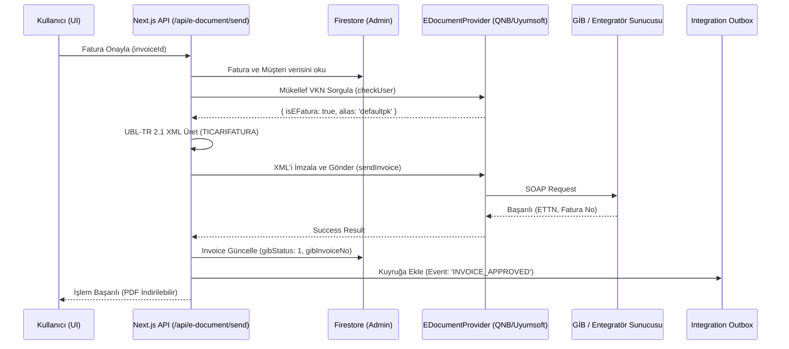
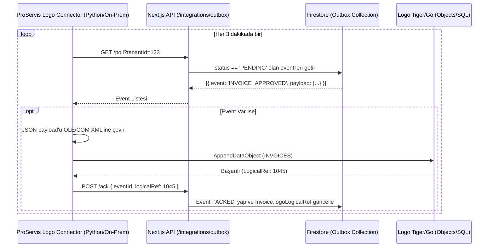

# ProServis Yeni Nesil Muhasebe, Finans ve e-Belge Mimari Planı
## Uçtan Uca Teknik Uygulama, Entegrasyon ve Veri Spesifikasyonu (v4.0 - Master Technical Blueprint)

> **Doküman Türü:** Sistem Mimarisi Detaylı Teknik Şartnamesi (Senior Architecture RFC & Master Specification)  
> **Hazırlayan:** Antigravity Senior Architect  
> **Durum:** 🟢 Onaylandı ve Uygulamaya Hazır (Production-Ready)  
> **Kapsam:** `proservis-web` (Next.js App Router, Firebase/Firestore), `proservis-agent-desktop` (Python), GİB e-Belge Motoru, Banka Mutabakatı, Taksit/Çek ve Logo Tiger/Go3 Entegrasyon Hattı.  

---

## 1. Yönetici Özeti ve Mimari Prensipler

ProServis ekosistemi, **Firebase/Firestore** ve **Next.js App Router** üzerinde yükselmektedir. Bu plan, önceki taslaklardaki tüm ilişkisel veritabanı (RDBMS/Prisma/PostgreSQL) varsayımlarını ortadan kaldırır ve doğrudan Firestore'un doğasına (NoSQL, hiyerarşik yapı, asenkronluk) uygun, ölçeklenebilir ve spagetti koddan arındırılmış bir finans/muhasebe omurgası kurmayı hedefler.

**Temel Prensipler:**
1. **Kuruş Bütünlüğü (Minor Units):** Firestore'da `Decimal` veri tipi bulunmaz. Finansal kayıpları ve float (kayan nokta) hatalarını engellemek adına tüm yeni finansal alanlar veritabanında **tam sayı kuruş (minor unit)** olarak saklanacaktır (Örn: 100.50 TL -> `10050`). Arayüze çıkarken formatter'lar kullanılacaktır.
2. **Zero-Trust Sunucu İzolasyonu:** Hiçbir özel entegratör (QNB, Uyumsoft vb.) API şifresi veya SOAP/REST çağrısı istemcide (`src/services/*`) yer almayacaktır. Tüm e-belge işlemleri `src/lib/server/...` dizininde, Next.js API route'ları ve **Firebase Admin SDK** üzerinden gerçekleştirilecektir.
3. **Transactional Outbox Deseni:** Logo vb. yerel ağ (On-Prem) sunucularına veri itmek (Push) NAT/Firewall sorunları yaratır. Bu yüzden Firestore tabanlı bir **Outbox Kuyruğu** kurularak Logo Connector ajanının veriyi çekmesi (Pull) sağlanacaktır.

---

## 2. Firestore Veri Modeli ve Şema Değişiklikleri

### 2.1 Mevcut `Invoice` ve `InvoiceItem` Genişletmesi
UBL-TR standardına uyum ve entegrasyonlar için mevcut yapıyı bozmadan yapılacak eklemeler:

```typescript
// Dosya: src/types/index.ts

export interface InvoiceItem {
  // ... Mevcut alanlar (description, quantity, unitPrice, total)
  
  // EKLENEN UBL-TR ZORUNLU ALANLARI:
  vatRate: number;                  // Satır bazlı KDV oranı (Örn: 20)
  unitCode: string;                 // GİB Birim Kodu (Örn: 'C62' - Adet, 'KGM' - Kilogram)
  discountAmountMinor?: number;     // Kuruş cinsinden iskonto
  withholdingCode?: string;         // Tevkifat Kodu (Örn: '601')
  withholdingRate?: number;         // Tevkifat Oranı (Örn: 20 -> %20)
  exemptionCode?: string;           // İstisna Kodu (Örn: '250')
  exemptionReason?: string;         // İstisna Sebebi
}

export interface Invoice {
  // ... Mevcut alanlar KORUNUYOR (gibEttn, gibInvoiceNo, totalAmount vb.)
  
  // YENİ E-BELGE SAĞLAYICI ALANLARI:
  eDocProvider?: 'gib_portal' | 'qnb' | 'uyumsoft';
  eDocumentType?: 'E_INVOICE' | 'E_ARCHIVE' | 'E_WAYBILL';
  eInvoiceProfile?: 'TEMELFATURA' | 'TICARIFATURA' | 'EARSIVFATURA';
  
  // YENİ FİNANS & MUTABAKAT ALANLARI:
  paymentPlanId?: string;           // Taksitli satıldıysa PaymentPlan doküman referansı
  isReconciled?: boolean;           // Banka ekstresiyle kapatıldı mı?
  reconciledTransactionIds?: string[]; // Eşleşen banka hareketlerinin ID'leri
  
  // ENTEGRASYON ALANLARI:
  logoSyncStatus?: 'PENDING' | 'SYNCED' | 'FAILED';
  logoLogicalRef?: number;          // Logo içerisindeki kayıt ID'si
}
```

### 2.2 Yeni Koleksiyon: `PaymentPlan` ve `PaymentInstallment` (Taksit & Senet Motoru)
Taksitli cihaz/hizmet satışlarının takibi için `/tenants/{tenantId}/payment_plans/{planId}` yapısı kurulacaktır. Kiralama işlemleri mevcut `contractService.ts` üzerinden dönemsel fatura üreterek devam edecektir.

```typescript
export interface PaymentPlan {
  id: string;
  tenantId: string;
  customerId: string;
  invoiceId: string;                // Hangi faturaya ait?
  totalAmountMinor: number;         // Toplam Tutar (Kuruş)
  downPaymentMinor: number;         // Peşinat (Kuruş)
  installmentCount: number;         // Taksit Sayısı
  status: 'ACTIVE' | 'COMPLETED' | 'DEFAULTED';
  createdAt: Timestamp;
}

export interface PaymentInstallment {
  id: string; // planId_1, planId_2
  planId: string;
  dueDate: string;                  // YYYY-MM-DD
  amountMinor: number;              // Kuruş Bütünlüğü Korunmuş Tutar
  paidAmountMinor: number;          // Tahsil Edilmiş Kuruş
  status: 'PENDING' | 'PARTIAL' | 'PAID' | 'OVERDUE';
  chequeId?: string;                // Çek ile ödendiyse çek referansı
}
```

### 2.3 Yeni Koleksiyon: `Cheques` (Çek Durum Makinesi)
Müşteriden alınan çeklerin yaşam döngüsü takibi:

```typescript
export type ChequeStatus = 
  | 'PORTFOLIO' // Cüzdanda
  | 'DEPOSITED' // Bankaya Tahsile Verildi
  | 'COLLECTED' // Banka Hesabına Geçti (Gerçek Tahsilat)
  | 'BOUNCED'   // Karşılıksız
  | 'ENDORSED'; // Ciro Edildi

export interface Cheque {
  id: string;
  tenantId: string;
  customerId: string;               // Çeki veren
  bankName: string;
  chequeNumber: string;
  amountMinor: number;
  dueDate: string;                  // YYYY-MM-DD
  status: ChequeStatus;
  linkedInstallmentIds?: string[];  // Hangi taksit(leri) kapatmak için verildi?
  createdAt: Timestamp;
}
```

---

## 3. Mimari Tasarım: Soyutlama ve Diziler (Folder Structure)

Projede Spagetti kod oluşmasını engellemek için S.O.L.I.D prensiplerine uygun, sağlayıcı bağımsız bir klasör mimarisi inşa edilecektir.

```text
proservis-web/
├── src/
│   ├── lib/
│   │   └── server/
│   │       ├── eDocument/                      # (SERVER-ONLY) e-Belge Çekirdeği
│   │       │   ├── EDocumentProvider.ts        # Ortak Arayüz (Interface)
│   │       │   ├── GibPortalProvider.ts        # Mevcut portal adapter'ı
│   │       │   ├── QnbIntegratorProvider.ts    # QNB SOAP İstemcisi
│   │       │   └── UblBuilder.ts               # UBL-TR 2.1 XML Üreticisi
│   │       └── outbox/
│   │           └── OutboxService.ts            # Firestore integration_outbox kuyruk yöneticisi
│   ├── app/
│   │   ├── api/
│   │   │   ├── e-document/                     # GİB/Entegratör tetikleyici uç noktaları
│   │   │   │   └── send/route.ts
│   │   │   └── integrations/
│   │   │       └── outbox/                     # Logo vb. ajanların veriyi PULL edeceği uç noktalar
│   │   │           ├── poll/route.ts
│   │   │           └── ack/route.ts
│   │   └── dashboard/
│   │       ├── e-documents/                    # Yeni e-Belge ve e-İrsaliye Listesi UI
│   │       └── finance/
│   │           ├── bank-reconciliation/        # Ekstre İçe Aktarma ve Eşleştirme Ekranı
│   │           ├── payment-plans/              # Taksit Sözleşmeleri Ekranı
│   │           └── cheques/                    # Çek Portföyü UI
│   └── services/                               # (CLIENT-SIDE) Firebase Client SDK İstemcileri
│       ├── finance/
│       │   ├── chequeService.ts
│       │   └── paymentPlanService.ts
│       └── integrationClientService.ts         # Arayüzün API route'ları ile konuşmasını sağlayan proxy
```

---

## 4. Kritik İş Akışları (Sequence Diagrams)

### 4.1 Çoklu Sağlayıcılı e-Fatura Gönderim Akışı



### 4.2 Logo Tiger Outbox/Pull Entegrasyon Akışı



---

## 5. Uygulama Adımları ve Fazlandırma (Mühendislik Görev Dağılımı)

### FAZ 0: Temeller ve Veri Temizliği (Hafta 1)
- [ ] `src/types/index.ts` dosyasına yeni UBL (KDV, birim) ve Finansal alanların eklenmesi.
- [ ] `proservis-web` içerisinde Kuruş/Lira dönüşümleri için ortak utils fonksiyonlarının (`centsToTl`, `tlToCents`) yazılması.
- [ ] Mevcut fatura oluşturma akışlarında (Servis, CPC vb.) `InvoiceItem.vatRate` ve `unitCode` alanlarının doldurulmasının sağlanması.

### FAZ 1: Core e-Belge Motoru ve Entegratör Adaptasyonu (Hafta 2)
- [ ] `src/lib/server/eDocument/EDocumentProvider.ts` arayüzünün oluşturulması.
- [ ] `UblBuilder.ts` yazılarak `Invoice` objesinden geçerli, Schematron uyumlu UBL-TR 2.1 XML üreten motorun kurulması (QNBFinansGIB reposundaki XMLIslemleri.cs baz alınarak TypeScript'e çevrilecektir).
- [ ] QNB veya Uyumsoft için SOAP istemcisinin (`QnbIntegratorProvider.ts`) yazılması.
- [ ] `/api/e-document/send` uç noktasının oluşturulması ve mevcut UI'daki SMS Modal'ının entegratör kullanılan tenant'lar için bypass edilmesi.

### FAZ 2: Finans, Taksit ve Çek Motoru (Hafta 3)
- [ ] `PaymentPlan` ve `Cheque` koleksiyon modellerinin sisteme entegre edilmesi.
- [ ] `paymentPlanService.ts`: "Kuruş artığı son taksite ekleme" algoritmasının (`ROUND_DOWN`) implemente edilmesi.
- [ ] Çekler için `chequeService.ts` üzerinden durum makinesinin (Portfolio -> Deposited -> Collected) yazılması.
- [ ] Yeni finans ekranlarının `/dashboard/finance/...` altında Next.js sayfaları olarak tasarlanması.

### FAZ 3: Banka Mutabakatı (Reconciliation) (Hafta 4)
- [ ] Ekstre içe aktarma arayüzünün yapılması (CSV/Excel Upload).
- [ ] Yüklenen veriyi normalize eden parser'ın yazılması (Tarih, Açıklama, Alacak).
- [ ] Ağırlıklı eşleştirme motorunun (Tutar %50, Tarih %30, İsim/FaturaNo %20) kodlanması.
- [ ] Onaylanan satırların, Fatura tahsilatı (`Invoice.paidAmount`) olarak işlenmesi.

### FAZ 4: Logo Outbox Entegrasyonu (Hafta 5)
- [ ] ProServis Backend tarafında `/api/integrations/outbox` route'larının (poll ve ack) yazılması.
- [ ] Yeni Python tabanlı `proservis-logo-connector` ajan projesinin başlatılması.
- [ ] Python ajanının ProServis API'sinden veri çekip Logo Objects'e (`logo_objects.py`) yazma işlemlerinin tamamlanması.

---

## 6. Kalite Güvencesi ve Önemli Uyarılar
* **GİB Validasyonu:** Üretilen tüm XML'ler canlıya çıkmadan önce resmi GİB test ortamında (veya bir Schematron validator kütüphanesi ile) test edilmelidir.
* **Tarih Saat Dilimi:** Tüm vadeler `YYYY-MM-DD` string formatında tutulmalıdır. Firestore `Timestamp` kullanıldığında UTC kaynaklı gün kaymaları (İstanbul saatinde gece 03:00'e denk gelme) yaşanabilir. Finansal vadelerde net takvim günü esastır.
* **Migrasyon Stratejisi:** Mevcut portal yapısındaki faturalar aynen korunacaktır. Yalnızca yeni kesilecek faturalar için yeni `eDocProvider` sistemi devreye alınacak, eski faturaların PDF'leri eski yöntemle gösterilmeye devam edilecektir (Fallback).
